# AdhikarVani · अधिकार-वाणी

**Your rights, in your voice.** AdhikarVani turns any government notification, scheme guideline or municipal bye-law into a *verified Rights Card*: every fact is proven with the exact words from the document, eligibility conditions are compiled into executable rules, and a voice assistant checks a citizen's eligibility in 11 Indian languages.

Track: **Theme 1, Civic Pulse, Digital Governance & Public Information**, problem 1 (*Multilingual Policy, Rights & Scheme Explainer*).

---

## Why this is different

Most "explain this policy" tools are a chatbot over a PDF. They paraphrase, they hallucinate amounts and ages, and they decide eligibility by guessing. AdhikarVani treats a policy like source code and **compiles** it:

| | Typical RAG chatbot | AdhikarVani |
|---|---|---|
| Facts | Paraphrased, unverifiable | Each fact carries a verbatim quote that code string-matches against the document (page and clause shown) |
| Hallucinations | Shown to the user | Rejected by a *hallucination firewall*, repaired once by the agent, and listed as rejected |
| Eligibility | LLM opinion per question | Typed rules evaluated by a deterministic three-valued engine; every verdict cites the clause |
| Questions asked | Fixed forms | The planner asks only for the fact that can still change a verdict |
| Many schemes | One LLM call per scheme | *Benefit Radar*: one conversation is checked against every compiled scheme at zero AI cost |
| Numbers spoken | Unchecked | Every amount, age and date in the explanation must exist in the verified facts, or it is rewritten |
| Languages | Usually English | Voice in and out in Hindi, Bengali, Marathi, Telugu, Tamil, Gujarati, Kannada, Malayalam, Punjabi, Urdu, English |
| Scanned / Kruti Dev Hindi PDFs | Garbage text | Detected and OCR'd with automatic script detection |

## Live data only

There is no seeded or mock data in the app. Inputs are:
* **Press Information Bureau RSS** (English and Hindi), fetched live on the home page.
* **Any official document URL** (PDF, web page, scanned copy) or an uploaded file. Landing pages that only link to a PDF are followed automatically.
* Compiled cards are persisted to a **Hugging Face dataset** (`<user>/adhikarvani-store`) so they survive restarts. Citizen answers are never stored.

## Architecture

```mermaid
flowchart LR
  subgraph SRC["Live official sources"]
    PIB["PIB press releases (RSS, en/hi)"]
    URL["Any .gov.in / .nic.in link"]
    UP["Uploaded PDF, scan or photo"]
  end
  subgraph CMP["Policy-as-Code compiler (agentic state graph)"]
    F["Fetch + SSRF guard + TLS fallback"] --> P["Read: PDF text, Tesseract OCR, legacy-font detection"]
    P --> S["Split into citable clauses C1..Cn"]
    S --> R["Intent-aware BM25 + rank fusion"]
    R --> X["LLM: atomic claims + verbatim quotes"]
    X --> V{"Verify: quote match + entailment"}
    V -- "failures (1st pass)" --> SC["LLM self-correction"] --> V
    V --> FW["Hallucination firewall"]
    FW --> RC["LLM: compile eligibility rules"]
    RC --> TC{"Type-check against variable catalog"}
    TC -- "errors (retry once)" --> RC
    TC --> EX["LLM: explainer in 11 languages + numeric fidelity check"]
    EX --> TTS["Neural TTS (Edge) / gTTS fallback"]
  end
  subgraph AG["Citizen voice agent"]
    MIC["Voice or text"] --> ASR["Whisper large-v3 (Groq) / Gemini audio"]
    ASR --> FX["LLM: facts + evidence-in-transcript check"]
    FX --> ENG["Deterministic 3-valued rules engine"]
    ENG --> PL["Next-question planner"]
    PL --> RP["LLM reply + numeric check"] --> SPK["Neural TTS"]
  end
  SRC --> F
  TTS --> DB[("Rights Cards (JSON) mirrored to a HF Dataset")]
  DB --> ENG
  RT["LLM router with failover: Gemini, Groq, Cerebras, Mistral, OpenRouter"] -.-> X & SC & RC & EX & FX & RP
```



The compiler's live state graph is also served at `/api/graph` and drawn on the app's *How it works* page.

### Pipeline in one paragraph
A document is fetched (private-network addresses blocked, redirects re-checked, size capped), read with PDFium, and sent through Tesseract OCR when pages are scanned or typed in legacy Hindi fonts. It is split into numbered clauses with page and section. BM25 ranks clauses against eight citizen intents in English and Hindi and the best evidence is packed into whatever context the chosen model allows. The LLM must return atomic claims with verbatim quotes and clause ids; code verifies each quote (exact, fuzzy for OCR noise, or relocated if the model cited the wrong clause) and a second model checks the quote actually supports the claim. Failures go back to the agent once; whatever still fails is rejected. Verified eligibility and exclusion claims are compiled into JSON logic over a shared variable catalog and type-checked; type errors trigger one repair round. A spoken explainer is written in the chosen language and every number in it is checked against the verified facts before it is synthesised.

## Tech stack

| Layer | Choice |
|---|---|
| Backend | Python 3.11, FastAPI, Server-Sent Events for the live agent trace |
| LLMs (free tiers) | Google Gemini Flash (long-context extraction), Groq (gpt-oss, Llama; fast checks), optional Cerebras, Mistral, OpenRouter; automatic model discovery and failover |
| Speech | Whisper large-v3 on Groq (ASR), Microsoft Edge neural voices via `edge-tts` and gTTS fallback (TTS), ffmpeg |
| Documents | PDFium (`pypdfium2`), Tesseract OCR with 11 Indic language packs, trafilatura, BeautifulSoup |
| Retrieval and verification | Custom BM25 with Unicode-aware tokenisation, reciprocal rank fusion, RapidFuzz |
| Persistence | JSON documents mirrored to a Hugging Face dataset with `CommitScheduler` |
| Front end | Vanilla HTML/CSS/JS, MediaRecorder for voice, no build step |
| Deploy | Docker Space on Hugging Face, deployed by GitHub Actions with a live end-to-end check |

## Run it locally

```bash
git clone https://github.com/<you>/adhikarvani && cd adhikarvani
sudo apt-get install ffmpeg tesseract-ocr tesseract-ocr-hin      # macOS: brew install ffmpeg tesseract tesseract-lang
python -m venv .venv && source .venv/bin/activate
pip install -r requirements.txt -r requirements-dev.txt
export GEMINI_API_KEY=...   # free: https://aistudio.google.com/apikey
export GROQ_API_KEY=...     # free: https://console.groq.com/keys
uvicorn app.main:app --reload --port 7860
# open http://localhost:7860
pytest -q                   # 20 tests, no network needed
```

Or with Docker: `docker build -t adhikarvani . && docker run -p 7860:7860 -e GEMINI_API_KEY -e GROQ_API_KEY adhikarvani`.

### Environment variables

| Variable | Required | Purpose |
|---|---|---|
| `GEMINI_API_KEY` | one of these two | Long-document extraction, multilingual writing, audio fallback |
| `GROQ_API_KEY` | one of these two | Whisper speech recognition, fast checks, LLM fallback |
| `CEREBRAS_API_KEY`, `MISTRAL_API_KEY`, `OPENROUTER_API_KEY` | no | Extra failover capacity |
| `HF_TOKEN` | no | Persist compiled cards to a Hugging Face dataset |
| `HF_DATASET_REPO` | no | Dataset name (default `<space owner>/adhikarvani-store`) |
| `ADMIN_KEY` | no | Enables `DELETE /api/policies/{id}` |

## Deployment (GitHub to Hugging Face)

Every push to `main` runs `.github/workflows/deploy.yml`:
1. unit and pipeline tests;
2. uploads the code to the Docker Space `<hf-user>/adhikarvani` and copies the API keys from GitHub secrets into Space secrets;
3. while the Space builds, runs `scripts/live_check.py`: pings every AI provider, does a Hindi TTS→ASR round trip, fetches the PIB feed and official PDFs, and compiles a real scheme document end to end;
4. waits for the Space and checks `/api/health`;
5. writes the report to the job summary and the `ci-reports` branch.

Repository secrets needed: `HF_TOKEN` (write), `GEMINI_API_KEY`, `GROQ_API_KEY`.

## API

| Method | Path | What it does |
|---|---|---|
| GET | `/api/health` | Providers, active models, voice and storage status |
| GET | `/api/pulse?lang=en\|hi` | Live PIB press releases |
| POST | `/api/compile` | Form field `url` or file `file`, plus `lang`; returns `job_id` |
| GET | `/api/jobs/{id}/events` | Live agent trace (SSE); `/api/jobs/{id}` to poll |
| GET | `/api/policies`, `/api/policies/{id}` | Compiled Rights Cards |
| POST | `/api/policies/{id}/explain` | Spoken explainer in another language |
| POST | `/api/agent/turn` | One voice (`audio`) or text turn; `mode=policy\|radar` |
| GET | `/api/graph` | The compiler state graph in Mermaid |

Interactive docs at `/docs`.

## Repository map

```
app/
  main.py        FastAPI routes, SSE, static files
  compiler.py    the state graph: nodes, prompts, self-correction loops, explainer
  llm.py         provider-agnostic router: discovery, failover, JSON repair
  ingest.py      fetching (SSRF-safe), PDF/HTML/image reading, OCR, legacy-font detection
  segment.py     clause segmentation with page and section
  retrieve.py    BM25, intent queries, context packing
  verify.py      quote verification and citizen evidence checks
  engine.py      three-valued rules engine, rule type-checker, question planner
  variables.py   canonical citizen-profile variables and unit conversion
  agent.py       the voice agent turn
  voice.py       ASR and TTS with fallbacks
  sources.py     live PIB feed
  store.py       JSON store mirrored to a Hugging Face dataset
static/          the web app
tests/           unit tests and a full pipeline test with the LLM mocked
scripts/         deploy and live-check scripts used by CI
docs/            study guide and submission text
```

## Limits we know about
* Free-tier rate limits: the router fails over between providers and waits for short cool-downs, but a burst of many large documents can still be slow.
* Some state portals block cloud servers; upload the PDF in that case.
* OCR quality depends on the scan; low-confidence text simply produces fewer verified facts, never invented ones.
* Discretionary conditions ("as decided by the committee") are listed as not compilable rather than guessed.

License: MIT.
